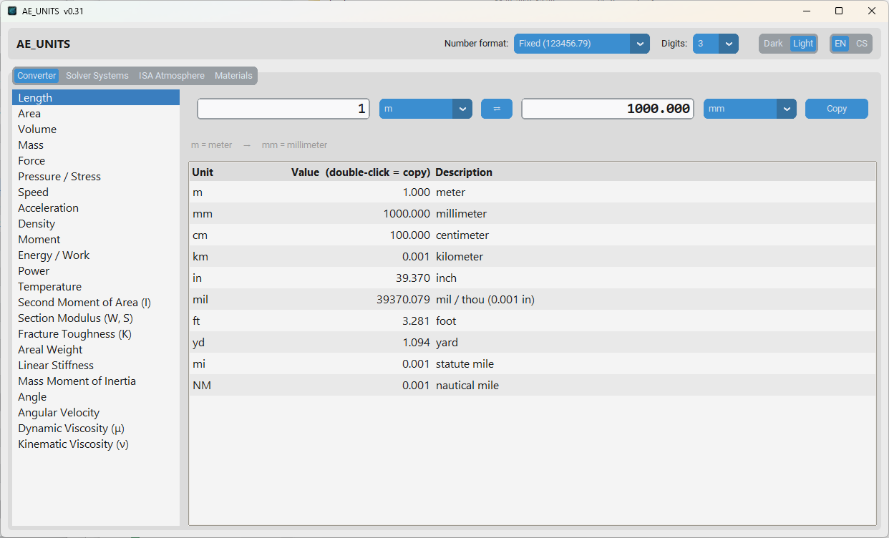

<h1>
  
  AE_UNITS
</h1>

Desktop utility for aerospace engineers and designers. Replaces ad-hoc Google searches for unit conversions, atmospheric data, and FEM/CFD solver unit systems. Bilingual — CS / EN.

[](https://github.com/mrSpringpeace/AE_UNITS/actions/workflows/tests.yml)


[](https://discord.gg/qHYEwrkfWm)



---

## Features

### Unit Converter
28 categories, ~145 units — SI and imperial, covering the units found in Niu and Bruhn literature.

Live recalculation as you type. Entire table of all units updated at once — one glance answers "100 KTAS = ? m/s = ? km/h = ? ft/s". Double-click any table row to copy the value. Type a unit into the search box (e.g. `psi`) to jump straight to its category.

| Category | Notable units |
|---|---|
| Length | m, mm, in, ft, NM |
| Speed | m/s, kt (KTAS/KIAS/KEAS), ft/min, mph |
| Pressure / Stress | Pa, MPa, psi, ksi, psf, kgf/mm² |
| Force | N, kN, lbf, kip, kgf |
| Mass | kg, slug, slinch (lbf·s²/in) |
| Density | kg/m³, t/mm³ (Abaqus), lb/in³, slug/ft³ |
| Second Moment of Area | m⁴, mm⁴, in⁴ |
| Fracture Toughness | MPa·√m, ksi·√in |
| Areal Weight | kg/m², g/m², oz/yd² (fabric) |
| Temperature | K, °C, °F, °R — plus a separate ΔT category (no offset!) |
| Running Load / Shear Flow | N/mm, kN/m, lbf/in, lbf/ft |
| Mass Flow | kg/s, kg/h, lb/min, lb/h |
| SFC | TSFC g/(kN·s), lb/(lbf·h) · BSFC g/(kW·h), lb/(hp·h) |
| … and more | moment, energy, power, viscosity, spring stiffness, angular velocity… |

### Solver Unit Systems
Pick a solver → see consistent unit system combinations with reference material values:

- **Abaqus** — SI (m), SI (mm/t/s), US (in/slinch), US (ft/slug)
- **Nastran** — same + `WTMASS` note for lb/in³ density models
- **OpenFOAM** — SI only; note on kinematic pressure p/ρ for incompressible solvers
- **PAM-CRASH** — (mm/g/ms) → MPa and (mm/kg/ms) → GPa crash systems

Each table includes reference material properties (steel, aluminium) in every unit system.

### ISA Atmosphere
US Standard Atmosphere 1976, 0–86 km.

- Input: altitude in m / ft / km / FL — **geometric or pressure altitude** (toggle), optional ΔISA offset
- Output: T, p, ρ, speed of sound (m/s + kt), dynamic and kinematic viscosity, σ, δ, θ, **1/√σ** (TAS↔EAS factor), geometric / geopotential / **density altitude**
- Built-in **σ/δ/θ profile plot** with a marker at the current altitude (native canvas — no plotting library needed)

### Airspeed Calculator
Compressible subsonic conversions tied to the ISA model:

- Input: altitude (pressure or geometric) + ΔISA + speed as **CAS / EAS / TAS / Mach** in kt, km/h, m/s, mph, ft/s
- Output: all four speed definitions side by side, dynamic pressure **q = ½ρV²** (Pa + psf), impact pressure q_c, speed of sound, 1/√σ
- Honest about IAS: IAS = CAS + instrument/position error — the app says "IAS ≈ CAS" instead of pretending to know your calibration curve

### Materials Reference
29 common aerospace materials with **SI and imperial side by side**, full-text search, and user-editable library:

Al 2024-T3, 2014-T6, 6061-T6, 6082-T6, 7075-T6/-T73, 7050-T7451, 5052-H32 · Mg AZ31B · Ti-6Al-4V, Ti-3Al-2.5V, Ti Grade 2 · Steel 4130, 4340, 300M, 17-4PH, 15-5PH, 304 · Inconel 718 · C/epoxy UD, fabric and quasi-isotropic · E-glass/epoxy · Kevlar 49/epoxy · Sitka spruce · Birch ply · Rohacell 51 IG · Divinycell H80 · Balsa

Add your own materials — saved automatically to `user_materials.json`. Export/import JSON libraries to share with colleagues.

### Table export
Any table (converter, solver systems, ISA, airspeed, materials) can be copied to the clipboard as TSV (pastes straight into Excel) or saved as CSV — two toolbar buttons, always acting on the active tab.

> ⚠️ Indicative typical values only. For structural substantiation use MMPDS / CMH-17 or the material data sheet.

---

## Installation

**Requirements:** Python 3.11+, Windows (primary); Linux/macOS may work for development.

```bash
pip install -r requirements.txt
python main.py
```

User settings and custom materials are stored next to the sources in development, or in `%APPDATA%\AE_UNITS` for frozen builds. Place an empty file named `portable` next to the `.exe` to keep data beside the executable instead.

### Standalone executable (no Python required)
Pre-built `.exe` releases are available on the [Releases](../../releases) page.

To build yourself (PyInstaller):
```bash
pip install -r requirements-build.txt
BUILD_EXE.bat
```
Or equivalently:
```bash
python -m PyInstaller --noconfirm main.spec
```
(`main.spec` collects CustomTkinter assets and produces `dist\AE_UNITS.exe`.)

Nuitka alternative: `BUILD_EXE_NUIT.bat`

---

## Project structure

```
AE_UNITS/
├── main.py
├── requirements.txt
├── requirements-build.txt
├── main.spec              # PyInstaller (collects CustomTkinter)
├── core/
│   ├── units.py           # unit definitions and conversion engine
│   ├── isa.py             # ISA 1976 model + pressure/density altitude inversion
│   ├── airspeed.py        # CAS/EAS/TAS/Mach compressible conversions
│   ├── formatting.py      # global number format state
│   ├── i18n.py            # localization engine (CS / EN)
│   ├── paths.py           # resource / writable dirs (dev, PyInstaller, Nuitka)
│   ├── settings.py        # persistent user settings (settings.json)
│   └── user_materials.py  # custom material persistence
├── data/
│   ├── solver_systems.py  # FEM/CFD unit system tables
│   └── materials.py       # built-in material database (CS + EN)
├── lang/
│   ├── cs.py              # Czech UI strings
│   └── en.py              # English UI strings + quantity map
├── gui/
│   ├── app.py             # main window, toolbar (format, theme, language, export)
│   ├── theme.py           # dark/light palette for native Tk widgets
│   ├── export.py          # table → CSV / clipboard
│   ├── tab_converter.py
│   ├── tab_solvers.py
│   ├── tab_isa.py
│   ├── tab_airspeed.py
│   ├── tab_materials.py
│   └── dialog_material.py
├── docs/
│   └── screenshot.png
└── tests/
    ├── test_units.py
    ├── test_isa.py
    ├── test_airspeed.py
    ├── test_materials.py
    ├── test_user_materials.py
    └── test_settings.py
```

---

## Conversion accuracy

All conversion factors are exact SI / NIST 2019 values where defined:

| Factor | Value |
|---|---|
| 1 in | = 0.0254 m (exact) |
| 1 lb | = 0.45359237 kg (exact) |
| 1 lbf | = 4.4482216152605 N (exact) |
| g₀ | = 9.80665 m/s² (exact) |

The test suite checks 36 known values from aerospace literature (Niu, Bruhn), runs a roundtrip test across all units in all categories, and validates the airspeed calculator against the classic M 0.80 / FL350 ≈ 272 KCAS reference point.

---

## Roadmap

- [x] Dynamic pressure calculator (q = ½ρV²) from ISA + airspeed → **Airspeed tab**
- [x] Export table to CSV / clipboard
- [x] Pressure-altitude input and density altitude in the ISA tab
- [x] Unit search across categories
- [x] ISA atmosphere profile plot (σ/δ/θ, native canvas)
- [x] More materials (29 entries: further Al alloys, Ti, steels, composites, cores)
- [x] v0.42 — ISA endpoint/ΔISA fixes, EN materials & OpenFOAM labels, portable/APPDATA data dir, packaging fixes

---

## Community

Questions, feedback, or feature ideas? Join the [AE_UNITS Discord server](https://discord.gg/qHYEwrkfWm).

---

## License

MIT
